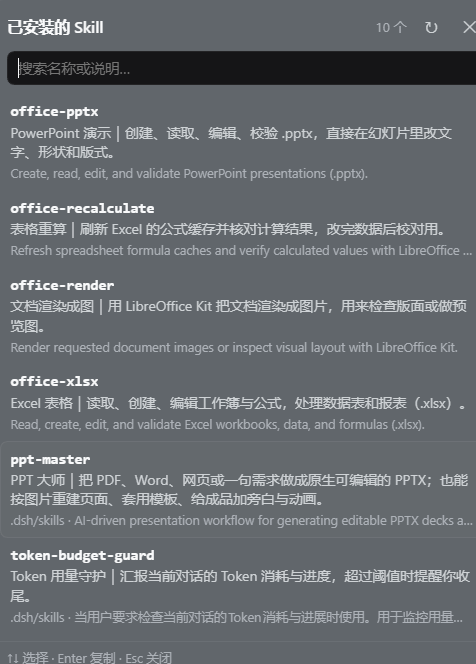

# dsh-skill-panel

[](./LICENSE)
[](https://github.com/maomaobishop/dsh-skill-panel/actions/workflows/test.yml)

A **Skills** button for the [DeepSeek Harness](https://github.com/deepseek-ai/deepseek-harness) sidebar: one click lists every skill the current session can use — with a Chinese one-liner, where it comes from, and what it does. Click a row to copy its `/name` invocation.

> 给 DeepSeek Harness 侧边栏加一枚「技能」按钮：点开就是当前会话可用的全部 skill，带中文说明、来源和最近使用，点一行把 `/名字` 复制到剪贴板。



## 功能

|          |                                                              |
| -------- | ------------------------------------------------------------ |
| **中文说明** | 每个 skill 配一句中文解释（`lib/zh.json`），界面显示为「中文名｜一句话说明」，英文原文降为次要行   |
| **中文搜索** | 搜索框同时匹配 名称 / 中文标题 / 中文说明 / 英文描述，敲「表格」也能找到 `office-xlsx`      |
| **键盘操作** | `↑` `↓` 选择、`Enter` 复制、`Esc` 关闭；鼠标悬停同步高亮                      |
| **最近使用** | 复制过的 skill 自动置顶（最多 3 个，存 localStorage），带「最近」标记               |
| **来源可见** | 每条标注来自 `.dsh/skills`、`.agents/skills` 还是插件自带，完整路径在 hover 提示里 |
| **翻译进度** | 底部显示「已翻译/总数」，提醒你还有哪几个没写中文                                    |
| **跟随主题** | 颜色全部走 `--dsw-alias-*` 主题 token，深浅色自动切换                       |

数据走官方 `skills/list` Remote，所以看到的目录与输入框里敲 `/` 得到的候选完全一致。

## 安装

需要 DeepSeek Harness（桌面端或 `dsh web`）+ Windows PowerShell。

```powershell
git clone https://github.com/maomaobishop/dsh-skill-panel.git
cd dsh-skill-panel
.\install.ps1                 # 装进 desktop profile
.\install.ps1 -Profile web    # 或 web profile
```

脚本只做三件事：把包复制到 `<profile>\plugins\`、在 `<profile>\node_modules\` 建 junction、在 profile 的 `package.json` 里登记 `dependencies` 与 `dsh.profile.bundles`。

**然后重启 DeepSeek Harness。** `bundles` 是启动期的组合，热加载只对已在运行的 entry 生效。

卸载：`.\uninstall.ps1`。

### 手动安装（不想跑脚本）

```powershell
$p = "$env:USERPROFILE\.dsh\profiles\desktop"
Copy-Item . "$p\plugins\dsh-skill-panel" -Recurse
cmd /c mklink /J "$p\node_modules\dsh-skill-panel" "$p\plugins\dsh-skill-panel"
# 然后在 $p\package.json 里：
#   dependencies 加  "dsh-skill-panel": "file:./plugins/dsh-skill-panel"
#   dsh.profile.bundles 末尾加  "dsh-skill-panel"
```

## 加中文说明

打开 `lib/zh.json`，按 skill 名加一条：

```json
{
  "skills": {
    "my-skill": { "title": "中文名", "summary": "一句话说清它干什么、什么时候该用。" }
  }
}
```

改完点面板右上角的「↻」即可生效，**不用重启**——词典由宿主路由 `GET /skill-panel/dictionary` 每次现读文件。没写中文的 skill 会退回英文描述，不会报错。

## 它是怎么工作的

| 半      | 文件              | 职责                                                                    |
| ------ | --------------- | --------------------------------------------------------------------- |
| Host   | `lib/index.js`  | 占一条 Loader row，并提供 `GET /skill-panel/dictionary` 把 `lib/zh.json` 发给面板 |
| Client | `lib/client.js` | 在 `sidebar.footer.action` 插槽里画按钮，向上弹出浮层                               |

客户端是手写的 lazy-CJS 工厂（`window.__ModuleLoader__.load({ id, factory })`），格式与官方发布的 client bundle 相同：外层只注册工厂，模块体在首次物化时才执行，**不需要构建步骤**，改完重启即生效。

## 踩过的坑（都写进代码注释了）

1. **点开就卡死**（0.1.1）：把 store 快照放进了加载 effect 的依赖数组。失败 → 状态回退 → 依赖变化 → 再请求 → 再失败，微任务永远排不空，整个渲染进程被占满。修法：加载 effect 只依赖 `open` / `sessionId`，用 `requestedRef` 保证每次打开最多自动请求一次。
2. **`cannot get property "remote" without inject`**（0.1.2）：Cordis 只注入 `inject` 里列出的名字。访问 `ctx.remote.skills` 时，`remote` 和 `remote.skills` 两个都要声明。
3. **bundle id 必须等于包名**：不一致会自动重试一次，变成重复注册，整个 web boot 失败。

## 测试

```powershell
npm install
npm test
```

- `test/render.mjs` — 用 `react-dom/server` 渲染按钮
- `test/interact.mjs` — jsdom 真交互：打开 → 中文说明 → 中文搜索 → `↑`/`Enter` 复制 → 最近使用 → `Esc` 关闭（20 条断言）
- `test/storm.mjs` / `test/storm2.mjs` — 失败路径回归：`skills/list` 报错时一次点击只能发 1–2 次请求，不许自我重试

## License

MIT © 2026 maomaobishop
